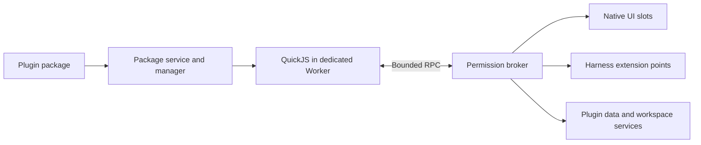

# Agent Note: DSH Web plugin system and package format

Status: proposed

English | [中文](2026-11-08-dsh-web-plugin-system.zh.md)

## Problem

The [current community format](../../../../apps/web/platform/plugin-community.md) installs isolated HTML pages with format version 1 and API number 1. It cannot provide harness tools, controlled session access, durable plugin data, transactional updates or per-operation permissions. Its checks establish declared compatibility, not whether arbitrary HTML implements its advertised behavior.

This proposal defines a new format version 2 and a separately versioned SDK 1.0 target. Neither is implemented by the current installer. It preserves format version 1 as an explicitly limited page format and does not silently reinterpret existing packages or grants.

## Proposal

### User capabilities and scope

A standard plugin may contribute panels, commands, model tools, settings, skills and theme tokens. The community discovers and distributes packages; an installed-plugin manager owns installation, enablement, grants, updates and removal. Installing a package does not execute it. Enabling it permits only its approved contributions, and model tools and skills additionally require selection for the relevant Session.

The first SDK excludes native processes, arbitrary Cordis imports, filesystem access outside a selected workspace, raw model credentials, unrestricted conversation rewriting and third-party code in the trusted application realm. npm dependencies are author-time build inputs and must be bundled; the browser never runs package-manager scripts. Browser hosting does not promise background execution after a tab closes or is suspended.

### Ownership and execution

| Component | Owns |
|---|---|
| Package service | Archive parsing, manifests, immutable package bytes and compatibility results |
| Plugin manager | Installation records, grants, active revisions and serialized changes per plugin |
| Sandbox runtime | One isolated execution instance, bounded jobs, cancellation and disposal |
| API broker | Caller identity, schema checks, permission checks and existing host-service calls |
| UI adapter | Native slot registrations and validated declarative views |
| Harness adapter | Existing tool, command, skill and Session extension points with durable logging |

The trusted application mounts these services as Cordis plugins. Registrations belong to effects and are withdrawn on disposal. Third-party packages receive an SDK proxy rather than Context or service instances. The community UI is a consumer of these services; its visibility does not own runtime lifetime. Existing [trusted client loading](../../implemented/architecture/2026-07-23-client-plugin-loading-model.md), [registry bundle updates](../../implemented/architecture/2026-10-14-registry-bundle-updates.md) and [Worker profile composition](../../implemented/architecture/2026-10-14-webworker-preview-profile-parity.md) retain their own decisions; this proposal adds a third-party trust model and does not replace those mechanisms.



### Runtime and UI security

Executable plugins use QuickJS compiled to WebAssembly inside a dedicated Worker, with a separate WebAssembly instance per active plugin. Only the trusted runner executes in the Worker JavaScript realm; package code is evaluated exclusively inside QuickJS. The runner exposes JSON-valued SDK functions, not browser objects, host functions, fetch, IndexedDB, DOM, process or require. A raw same-origin Worker alone would not provide this restriction. The maintained [QuickJS bindings](https://github.com/justjake/quickjs-emscripten) expose interruption, memory and stack controls; integration and supported-language conformance remain implementation work.

A plugin panel submits a bounded component tree composed of text, Markdown, fields, buttons, lists and tables. The trusted renderer owns DOM, focus, theme, accessibility and action dispatch. Markdown rejects raw HTML and unsafe URLs; assets are verified package resources. Views cannot submit JavaScript, CSS, event-handler strings, arbitrary URLs or trusted-framework nodes. A view action invokes a declared handler through the same permission broker as a tool.

Legacy HTML pages keep their opaque-origin iframe and receive no new host API. The [HTML sandbox specification](https://html.spec.whatwg.org/multipage/iframe-embed-object.html#attr-iframe-sandbox) separates script permission from same-origin permission. Neither an iframe nor connect-src restrictions establish complete network-egress prevention, so sensitive host data must not be supplied to legacy pages. Browser and engine vulnerabilities remain outside the guarantees of this design.

### Package container

A version 2 package is a ZIP archive with extension .dsh-plugin and one UTF-8 dsh-plugin.json at its root. Source projects may use any build tooling, but distributed packages contain runnable JavaScript and resources without install hooks. The package is self-contained and never resolves another installed plugin or downloads executable dependencies. A resource-only package uses runtime type declarative and cannot declare executable handlers.

```text
org.example.notes-1.0.0.dsh-plugin
├── dsh-plugin.json
├── dist/main.js
├── assets/icon.png
├── README.md
└── LICENSE
```

Archive entries use relative forward-slash paths. Reject absolute paths, dot segments, backslashes, drive prefixes, control characters, duplicate or case-colliding paths, symlinks, encrypted entries and unsupported compression methods. Enforce entry count, compressed bytes, per-file bytes and total expanded bytes while reading, before allocation or extraction can exceed policy. No archive is extracted into the application VFS or module tree.

### Manifest example

The following manifest is illustrative. File lengths and digests are build outputs, and the zero digest below is a placeholder rather than an installable artifact. All names shown to users are locale-owned values.

```json
{
  "format": "dsh-web-plugin",
  "formatVersion": 2,
  "id": "org.example.notes",
  "version": "1.0.0",
  "name": {
    "en": "Workspace notes",
    "zh-CN": "工作区便笺"
  },
  "description": {
    "en": "Keep notes beside your work",
    "zh-CN": "在工作时记录便笺"
  },
  "publisher": {
    "name": "Example community",
    "url": "https://example.org"
  },
  "license": "MIT",
  "engines": {
    "sdk": "^1.0.0"
  },
  "requires": {
    "features": [
      "ui.panels",
      "storage.kv",
      "tools.provide"
    ]
  },
  "runtime": {
    "type": "sandbox-js",
    "entry": "dist/main.js"
  },
  "activation": [
    "onPanel:notes",
    "onCommand:notes.open",
    "onTool:notes_get"
  ],
  "permissions": {
    "required": [
      {
        "name": "storage.kv",
        "quotaBytes": 1048576
      }
    ],
    "optional": [
      {
        "name": "workspace.read",
        "paths": [
          "notes/**"
        ]
      }
    ]
  },
  "contributes": {
    "panels": [
      {
        "id": "notes",
        "title": {
          "en": "Notes",
          "zh-CN": "便笺"
        },
        "handler": "notes.panel"
      }
    ],
    "commands": [
      {
        "id": "notes.open",
        "title": {
          "en": "Open notes",
          "zh-CN": "打开便笺"
        },
        "handler": "notes.open"
      }
    ],
    "tools": [
      {
        "id": "notes_get",
        "description": {
          "en": "Read a saved plugin note by key",
          "zh-CN": "按键名读取插件已保存的便笺"
        },
        "inputSchema": {
          "type": "object",
          "properties": {
            "key": {
              "type": "string",
              "maxLength": 120
            }
          },
          "required": [
            "key"
          ],
          "additionalProperties": false
        },
        "outputSchema": {
          "type": "object",
          "properties": { "text": { "type": "string" } },
          "required": ["text"],
          "additionalProperties": false
        },
        "handler": "notes.get",
        "permissions": [
          "storage.kv"
        ]
      }
    ]
  },
  "storage": {
    "schemaVersion": 1
  },
  "icon": "assets/icon.png",
  "files": {
    "dist/main.js": {
      "bytes": 1234,
      "sha256": "0000000000000000000000000000000000000000000000000000000000000000"
    },
    "assets/icon.png": {
      "bytes": 512,
      "sha256": "0000000000000000000000000000000000000000000000000000000000000000"
    },
    "README.md": {
      "bytes": 256,
      "sha256": "0000000000000000000000000000000000000000000000000000000000000000"
    },
    "LICENSE": {
      "bytes": 1024,
      "sha256": "0000000000000000000000000000000000000000000000000000000000000000"
    }
  }
}
```

### Manifest field rules

| Field | Rule |
|---|---|
| format and formatVersion | Exact discriminator dsh-web-plugin and integer 2 |
| id | Stable lowercase reverse-domain identifier with at least two dot-separated segments and at most 128 ASCII bytes |
| version | Exact SemVer 2.0 version No latest tags or ranges |
| name and description | Nonempty English fallback plus optional BCP 47 locale keys |
| publisher and license | Required display identity and SPDX license expression Publisher text is not identity verification |
| engines | Required sdk SemVer range Optional app range only when public SDK capabilities cannot express a dependency |
| requires.features | Required host capability identifiers Unsupported required identifiers block enablement |
| runtime | sandbox-js with one package-local ESM entry or declarative without an entry |
| activation | Explicit onPanel onCommand onTool or onStartup triggers Each target must exist in contributes |
| permissions | Required and optional scoped grants Unknown required permissions block enablement |
| contributes | Panels commands tools settings skills and theme declarations Only declared IDs can be registered |
| storage | Positive monotonic schemaVersion when plugin data exists Optional package-local migration entry |
| files | Every archive file except the manifest Exactly one byte count and lowercase SHA-256 per path No extra files |
| icon repository homepage | Optional package-local icon and HTTPS project links They confer no permissions |

Unknown executable or security-relevant fields are rejected. An optional extensions object may hold namespaced informational metadata but cannot affect execution or grant authority. Keys and contribution IDs are unique; handler references must resolve in the activation handshake. JSON input rejects duplicate keys. Relative module imports stay within verified package files; host modules and URL imports are refused. Build-time SDK helpers are bundled, while the host API is supplied to activate rather than imported from application packages.

Manifest, tool arguments and tool results use a pinned JSON Schema dialect and a documented supported keyword set. The target dialect is [JSON Schema 2020-12](https://json-schema.org/draft/2020-12); unsupported keywords, remote references and executable validators are rejected rather than ignored. Resource declarations reference package files or inline schema values, never live code strings. Schema documents and SDK declarations must be shipped from the same protocol source during implementation.

### Contribution records and entry protocol

panels and commands contain id, localized title and handler. A tool additionally requires localized description, inputSchema and outputSchema, and may name permissions already declared by the package. settings contains a declarative schema and validated defaults; secret values use host-owned connection references. A skill contains id, localized title and description, and a package-local Markdown path. A theme contains id, localized title and a map of approved token values. IDs are namespaced by plugin ID and cannot replace another plugin or built-in contribution. Executable declarations require sandbox-js; declarative packages contain only settings, skills and themes. Optional declarations may be omitted, but undeclared executable handlers cannot become public.

The module exports activate(api). api.handle(handlerId, callback) binds a declared handler; a panel callback returns a validated component tree, while a tool callback returns its outputSchema value. The host supplies an invocation descriptor to each callback. SDK calls carrying workspace, Session or model authority must include that live invocation token; the broker rejects tokens belonging to another plugin or generation, completed operations and expired tokens. Plugins never choose the authority by passing resource IDs. Tools map to provider-compatible names through the existing registry while their durable identity remains plugin ID, tool ID and package digest.

The private-port envelope uses protocol dsh-plugin-rpc, version 1, kind request, a unique requestId, a method and JSON params. Replies use kind result with result or kind error with a stable code and structured details; cancellation names an outstanding requestId. Identity and grants are never accepted as request fields. Message count and encoded byte limits apply to the complete envelope. Unsupported methods reject explicitly and notification subscriptions have bounded queues with a visible overflow error.

### SDK and contribution behavior

| SDK area | Operation and restriction |
|---|---|
| ui | Publish declarative panel state and receive validated actions |
| commands and tools | Bind declared handlers with JSON results cancellation and bounded execution |
| storage | Plugin-owned JSON values within the approved quota |
| workspace | Normalized selected-workspace paths within explicit grants |
| sessions | Current authorized invocation Session only |
| models | Host-managed logged model tasks with explicit spend approval |
| network | Host-mediated HTTPS requests to approved origins and methods |
| permissions | Inspect grants or request optional grants through trusted UI |
| events and log | Permitted projected events and bounded redacted diagnostics |

An executable module exports activate(api), which binds every declared executable handler and may return an asynchronous disposer. Installation never calls it. Activation has a preparation phase in which the runtime may read its approved local state and stage registrations but cannot perform network requests, model tasks, workspace writes or Session writes. The manager publishes registrations only after a successful handshake and commit; an asynchronous activated notification then permits ordinary operations. onStartup means the browser host is ready, not an operating-system background service.

Settings use a declarative form schema and locale dictionaries. Skills reference Markdown resources and enter a model request only when selected, with the actual admitted text logged. Themes assign approved visual tokens and never inject arbitrary CSS. Model-visible schemas, prompts, tool calls and results remain reconstructable from the Session log, including plugin ID, package digest and tool ID. Adapters register through existing extension points and preserve ordinary approval and execution policy; a plugin cannot obtain authority by invoking another tool through the broker.

### Permissions and invocation identity

Effective authority is the intersection of the package declaration, saved user grant, current workspace or Session authorization and host policy. Installation and required-permission approval are separate. Optional denial leaves unrelated contributions available; contributions depending on that permission are unavailable with a visible reason. A future grant is checked at every API operation, so withdrawing it takes effect for active runtimes and cancels affected subscriptions and pending work.

Each runtime receives one private MessagePort bound by the host to plugin ID, immutable package digest, activation generation and permitted invocation context. The host derives identity from that port and its operation record, never payload plugin IDs, supplied workspace IDs or Session IDs. Validate payloads, reply sizes, request IDs, deadlines, cancellation and generation on every message. Late replies cannot mutate a replacement runtime. No executable or host-object values cross this channel.

Initial privileged grants are storage.kv with a byte quota, workspace.read and workspace.write with selected workspace roots and path scopes, sessions.read limited to the trusted current invocation, models.invoke with model and spend limits, and network.fetch with exact HTTPS origins and HTTP methods. No wildcard origin grant is allowed initially. The broker refuses redirects, credential-bearing URLs and ambient cookies; it checks normalized workspace paths at the owning filesystem service. Credentials stay in host-owned connections and are never returned to plugins.

A plugin may retain legitimately received data in its approved storage; current-Session access is not a promise that the plugin will forget it. Reading data and transmitting data are distinct grants, but granting both enables that data to leave the device. The consent UI must describe this combination plainly. Model calls and remote network calls carry their actual inputs and resulting effects; the system must not describe them as local-only. Effects whose completion is uncertain after cancellation remain visibly uncertain and are never retried automatically.

### Compatibility and interception

| Stage | Decision |
|---|---|
| Discovery | Advisory compatibility from index metadata Unknown is shown explicitly |
| Download and inspection | Verify archive digest identity version paths file table and manifest before any code runs |
| Install and enable | Check supported format runtime SDK range required capabilities and required grants |
| Activation and API calls | Check runtime handshake handler completeness current grants policy and resource budgets |
| Host update or policy change | Re-evaluate all enabled plugins Suspend incompatible ones without deleting their data |

Compatibility has four outcomes: compatible, needs-consent, incompatible and unknown. needs-consent is not a version conflict; unknown cannot be enabled until inspection succeeds. A package incompatible with format, runtime or SDK cannot be enabled even after manual approval. SDK range matching uses a maintained SemVer implementation with prereleases excluded unless explicitly admitted by the range. Only the latest compatible version is offered for automatic update; a version requiring wider grants remains pending.

Stable errors include FORMAT_UNSUPPORTED, SDK_UNSUPPORTED, FEATURE_MISSING, PERMISSION_REQUIRED, INTEGRITY_MISMATCH, PUBLISHER_CHANGED, QUOTA_EXCEEDED, EXECUTION_TIMEOUT and MIGRATION_FAILED. Reports identify the affected plugin, required and available capability or version, and a safe action. Every install entry calls the same inspector and every API entry calls the same permission owner. Manifest checks cannot establish that arbitrary plugin behavior is correct; activation failures are contained separately.

### Index format and publisher trust

Index format version 2 is a bounded JSON document with format dsh-web-plugin-index, formatVersion 2 and a packages array. Each item has id, localized name and description, publisher display data and a releases array. A release pins version, package URL, compressed bytes, SHA-256, SDK requirement, required feature identifiers and required-permission summary. Package metadata is rechecked against the actual manifest; index content never grants authority. Relative URLs resolve against the index URL, and transport requires HTTPS except same-origin local development.

SHA-256 proves consistency with a selected release record, not the publisher. A signed release may carry an Ed25519 detached signature and keyId over UTF-8 bytes DSH-WEB-PLUGIN-V2 followed by newline, id, newline, version, newline, lowercase package SHA-256 and a final newline. IDs and versions cannot contain newlines. Verification uses host-trusted or explicitly pinned keys; an index cannot establish trust by supplying its own key. A valid signature under an unknown key remains unverified until accepted. Unsigned local installation requires explicit trust and cannot silently replace a signed installation.

The manager pins publisher key identity per installed plugin. A changed key blocks unattended replacement; authenticated key rotation or explicit re-trust is required. Reusing the same plugin ID and version with different bytes is rejected as a mutated release. Signature failures are rejected rather than downgraded to unsigned. Catalog withdrawal, author verification and malware review are separate community policy decisions, not claims made by this package format.

### Storage lifecycle and updates

IndexedDB owns immutable verified package blobs and the installation records that reference them. Plugin JSON data uses a plugin-ID namespace; migration prepares a new data generation. Network download, hashing and sandbox preparation happen outside write transactions. One short transaction commits the package reference, approved grants, active data generation and enabled state. A storage quota failure leaves the previous record intact. UI caches are derived from committed records rather than an independent localStorage inventory.

Installed plugin states are disabled, starting, active, stopping, suspended, failed and updating. Download and inspection are operation states rather than evidence of installation. Start creates one generation; stop first withdraws registrations, rejects new calls, cancels and awaits pending work, invokes the disposer within a deadline and finally terminates the Worker. A crash, budget overrun or lost permission removes only that plugin's contributions. Resource policy bounds VM memory and stack, interpreter execution, wall time, outstanding RPCs, schema complexity, view size, event queues and retained logs. Policy values are host configuration, not author-controlled tunables.

An update verifies and stages new bytes and requests any expanded grants while the old version remains available. It then quiesces the old runtime and migrates a snapshot of plugin-local data in an API-restricted migration runtime. storage.migrations declares adjacent from and to schema versions with a package-local entry; all steps from the installed version to the target must exist. A migration cannot access network, Sessions, models or workspace writes and must complete before a new generation is published. Preparation may not perform external effects. Failure before commit restores the old active reference and data generation; post-commit failures remain visible and do not claim that external effects were rolled back. Keep an old package and data snapshot for explicit recovery until a configured retention policy removes them.

Browser startup treats the committed IndexedDB record as authoritative, creates a fresh runtime generation and cleans unreferenced staging data. A per-plugin change transaction has one owner in the existing single-host browser architecture; additional tabs cannot independently update the same installation. Uninstall first stops the runtime and revokes grants, then removes the installation reference. User choice determines whether plugin data is kept for reinstall or deleted; no action claims to undo previously completed workspace or remote operations.

### Version 1 transition and delivery sequence

Retain the version 1 JSON reader, installer and storage record without rewriting them as version 2. Label those packages as page plugins with no SDK access. Export and reinstall remain possible. Authors explicitly rebuild and publish version 2 to acquire new contributions; users review its identity and grants. The new manager may show both formats but must not execute legacy HTML in the new privileged runtime or replace old data based only on an ID match.

Deliver the new container, inspector, IndexedDB records and compatibility display first. Next deliver QuickJS isolation, broker, private storage and declarative panels. Then attach commands, tools and skills through existing Harness registrations and logging. Introduce scoped workspace, Session, model and network operations only when their permission enforcement, cancellation and visible reporting are implemented. Signature verification and update transactions must precede unattended community updates. No stage advertises an API merely because its manifest syntax exists.

## Alternatives considered

**Arbitrary same-origin JavaScript or direct Cordis packages:** convenient reuse would also expose the application's ambient authority and trusted service objects. This is suitable only for code shipped with the product, not independently installed community packages.

**Iframe plus a privileged message bridge:** useful for independent web pages, but DOM execution and browser network surfaces make it an unsuitable foundation for strict data-access and egress grants. Keep it for unprivileged legacy pages rather than extending its authority.

**Declarative resources only:** the simplest approach covers skills and themes but cannot implement custom tool computation. Retain it as a runtime type alongside the restricted JavaScript runtime.

**Server execution of every plugin:** enables Node packages but adds a hosted execution service, authorization model and data transfer outside the browser. It does not fit the current browser-hosted product and would require a separate runtime and explicit product decision.

## Acceptance criteria

Implementation requires one focused scenario per newly introduced enforcement owner, not repeated full-suite runs: deny a forged or stale broker identity at the executor; preserve inventory after rejected archives or failed commits; interrupt an over-budget VM and withdraw its registrations; and keep original package and data references after a failed pre-commit migration. Add a real-composition command or tool case proving that admitted model input and its result are reconstructed from the Session log. Reuse these results for release rather than repeating them. No tests or benchmarks run for this design-only change.

## Risks

QuickJS adds a WASM download and execution overhead, and its bridge implementation is security-sensitive. The SDK must document supported language features instead of promising all browser or Node JavaScript. Declarative UI limits arbitrary visual layouts. These costs buy explicit host authority and a runtime that can be stopped independently of the main UI; they do not eliminate browser-engine defects or denial of service in every host allocation.

A public marketplace still needs publisher enrollment, moderation, abuse reporting and key-recovery policy before it can claim verified authors. Package signatures do not establish harmless behavior, and compatibility checks do not prove correctness. The implementation must keep those trust, compatibility and runtime-failure reports distinct.
