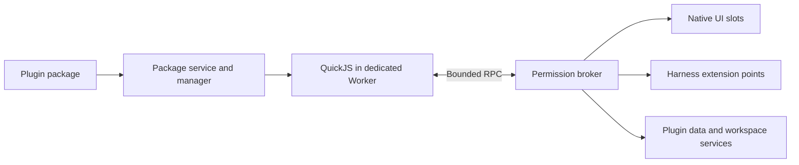

# Agent Note: DSH Web 插件系统与标准插件格式

Status: proposed

[English](2026-11-08-dsh-web-plugin-system.md) | 中文

## 问题

[现有社区格式](../../../../apps/web/platform/plugin-community.md) 安装格式版本 1 和 API 编号 1 的隔离 HTML 页面，尚不能提供 Harness 工具、受控会话访问、持久插件数据、事务化更新或逐操作权限。现有检查确认的是声明兼容性，无法证明任意 HTML 符合其宣传的行为。

本提案设计新的格式版本 2，以及独立版本管理的 SDK 1.0 目标。当前安装器尚未实现二者。格式版本 1 保留为能力明确受限的页面格式，现有插件包及授权不会被静默重新解释。

## 方案

### 用户能力与范围

标准插件可以贡献面板、命令、模型工具、设置、技能和主题令牌。插件社区负责发现和分发，已安装插件管理器负责安装、启停、授权、更新和卸载。安装不执行代码，启用仅开放已授权的贡献；模型工具和技能还需在相应会话中选用。

首版 SDK 不提供原生进程、任意 Cordis 导入、已选工作区之外的文件访问、模型密钥原文、任意对话重写或受信任应用环境中的第三方代码执行。npm 依赖仅用于作者构建，必须打包进产物；浏览器不执行包管理器脚本。浏览器宿主不承诺标签页关闭或挂起后继续后台执行。

### 职责与执行方式

| 组件 | 职责 |
|---|---|
| 插件包服务 | 归档解析、清单、不可变包内容和兼容性结果 |
| 插件管理器 | 安装记录、授权、当前版本及同插件变更串行化 |
| 沙箱运行时 | 独立执行实例、受限任务、取消和销毁 |
| API 代理 | 调用者身份、参数校验、权限检查和现有宿主服务调用 |
| 界面适配器 | 原生插槽注册和经过校验的声明式视图 |
| Harness 适配器 | 现有工具、命令、技能和会话扩展点及持久日志 |

受信任应用将这些服务挂载为 Cordis 插件，注册归属 effect，并在销毁时撤销。第三方插件只获得 SDK 代理，不获得 Context 或宿主服务实例。社区界面只是服务消费者，页面是否显示不决定运行时寿命。现有的 [受信任客户端加载](../../implemented/architecture/2026-07-23-client-plugin-loading-model.md)、[registry bundle 更新](../../implemented/architecture/2026-10-14-registry-bundle-updates.md) 和 [Worker profile 组合](../../implemented/architecture/2026-10-14-webworker-preview-profile-parity.md) 保留各自决策，本提案增加第三方信任模型，不替代这些机制。



### 运行时与界面安全

可执行插件采用独立 Worker 内的 QuickJS WebAssembly，每个活动插件拥有独立 WebAssembly 实例。只有受信任的运行器在 Worker 的 JavaScript 环境执行，插件代码仅在 QuickJS 内执行。运行器只暴露以 JSON 值交互的 SDK 函数，不暴露浏览器对象、宿主函数、fetch、IndexedDB、DOM、process 或 require。仅使用普通同源 Worker 无法提供此限制。维护中的 [QuickJS 绑定](https://github.com/justjake/quickjs-emscripten) 提供执行中断、内存和栈限制；集成及支持语言的一致性仍需在实现时完成。

插件面板提交由文本、Markdown、字段、按钮、列表和表格构成的受限组件树。受信任渲染器负责 DOM、焦点、主题、可访问性和操作分发。Markdown 拒绝原始 HTML 和危险链接，资源来自经过验证的包文件。视图不能提交 JavaScript、CSS、事件处理字符串、任意 URL 或受信任框架节点。视图操作与模型工具经过同一个权限代理调用已声明处理器。

旧 HTML 页面保留不透明来源 iframe，且不会获得新的宿主 API。[HTML 沙箱规范](https://html.spec.whatwg.org/multipage/iframe-embed-object.html#attr-iframe-sandbox) 将脚本权限和同源权限分开。iframe 或 connect-src 限制均不能证明完全禁止网络外发，因此不得向旧页面提供敏感宿主数据。浏览器及引擎漏洞不在本设计的保证范围内。

### 插件包容器

版本 2 插件包为扩展名 .dsh-plugin 的 ZIP 归档，根目录包含一个 UTF-8 编码的 dsh-plugin.json。源项目可以采用任意构建工具，分发包必须包含可直接运行的 JavaScript 与资源，且没有安装钩子。插件包独立完整，不解析其他已安装插件，也不下载可执行依赖。纯资源包使用 declarative 运行时类型，不得声明可执行处理器。

```text
org.example.notes-1.0.0.dsh-plugin
├── dsh-plugin.json
├── dist/main.js
├── assets/icon.png
├── README.md
└── LICENSE
```

归档条目使用正斜杠分隔的相对路径。拒绝绝对路径、点路径段、反斜杠、盘符前缀、控制字符、重复或大小写冲突路径、符号链接、加密条目和不支持的压缩方式。读取时限制条目数、压缩体积、单文件体积及解压总体积，在内存分配或解压超出策略前中止。归档不得解压进入应用 VFS 或模块目录。

### 清单示例

以下清单为格式示例。文件长度和摘要应由构建生成，下面的零摘要为占位值，不代表可安装产物。所有用户可见名称使用本地化值。

```json
{
  "format": "dsh-web-plugin",
  "formatVersion": 2,
  "id": "org.example.notes",
  "version": "1.0.0",
  "name": {
    "en": "Workspace notes",
    "zh-CN": "工作区便笺"
  },
  "description": {
    "en": "Keep notes beside your work",
    "zh-CN": "在工作时记录便笺"
  },
  "publisher": {
    "name": "Example community",
    "url": "https://example.org"
  },
  "license": "MIT",
  "engines": {
    "sdk": "^1.0.0"
  },
  "requires": {
    "features": [
      "ui.panels",
      "storage.kv",
      "tools.provide"
    ]
  },
  "runtime": {
    "type": "sandbox-js",
    "entry": "dist/main.js"
  },
  "activation": [
    "onPanel:notes",
    "onCommand:notes.open",
    "onTool:notes_get"
  ],
  "permissions": {
    "required": [
      {
        "name": "storage.kv",
        "quotaBytes": 1048576
      }
    ],
    "optional": [
      {
        "name": "workspace.read",
        "paths": [
          "notes/**"
        ]
      }
    ]
  },
  "contributes": {
    "panels": [
      {
        "id": "notes",
        "title": {
          "en": "Notes",
          "zh-CN": "便笺"
        },
        "handler": "notes.panel"
      }
    ],
    "commands": [
      {
        "id": "notes.open",
        "title": {
          "en": "Open notes",
          "zh-CN": "打开便笺"
        },
        "handler": "notes.open"
      }
    ],
    "tools": [
      {
        "id": "notes_get",
        "description": {
          "en": "Read a saved plugin note by key",
          "zh-CN": "按键名读取插件已保存的便笺"
        },
        "inputSchema": {
          "type": "object",
          "properties": {
            "key": {
              "type": "string",
              "maxLength": 120
            }
          },
          "required": [
            "key"
          ],
          "additionalProperties": false
        },
        "outputSchema": {
          "type": "object",
          "properties": { "text": { "type": "string" } },
          "required": ["text"],
          "additionalProperties": false
        },
        "handler": "notes.get",
        "permissions": [
          "storage.kv"
        ]
      }
    ]
  },
  "storage": {
    "schemaVersion": 1
  },
  "icon": "assets/icon.png",
  "files": {
    "dist/main.js": {
      "bytes": 1234,
      "sha256": "0000000000000000000000000000000000000000000000000000000000000000"
    },
    "assets/icon.png": {
      "bytes": 512,
      "sha256": "0000000000000000000000000000000000000000000000000000000000000000"
    },
    "README.md": {
      "bytes": 256,
      "sha256": "0000000000000000000000000000000000000000000000000000000000000000"
    },
    "LICENSE": {
      "bytes": 1024,
      "sha256": "0000000000000000000000000000000000000000000000000000000000000000"
    }
  }
}
```

### 清单字段规则

| 字段 | 规则 |
|---|---|
| format 和 formatVersion | 精确判别值 dsh-web-plugin 和整数 2 |
| id | 稳定的小写反向域名标识 至少两个点分隔段 最长 128 个 ASCII 字节 |
| version | 精确的 SemVer 2.0 版本 不接受 latest 标签或范围 |
| name 和 description | 必填非空英文回退值 其他键采用 BCP 47 语言标签 |
| publisher 和 license | 必填发布者展示信息和 SPDX 许可表达式 发布者文字不等于身份认证 |
| engines | 必填 sdk SemVer 范围 仅在公开 SDK 能力无法表达依赖时填写可选 app 范围 |
| requires.features | 必需宿主能力标识 不支持的必需能力阻止启用 |
| runtime | sandbox-js 指定一个包内 ESM 入口 或 declarative 且无入口 |
| activation | 显式声明 onPanel onCommand onTool 或 onStartup 触发点 目标必须存在于 contributes |
| permissions | 必需和可选的范围授权 未知必需权限阻止启用 |
| contributes | 面板 命令 工具 设置 技能和主题声明 只能注册已声明的 ID |
| storage | 有插件数据时声明单调递增的正整数 schemaVersion 可指定包内迁移入口 |
| files | 清单之外的所有归档文件 每个路径对应唯一字节数和小写 SHA-256 不允许额外文件 |
| icon repository homepage | 可选包内图标及 HTTPS 项目链接 不产生权限 |

拒绝未知的执行或安全相关字段。可选 extensions 对象可以存放带命名空间的说明性元数据，但不能影响执行或产生授权。键名和贡献 ID 必须唯一，处理器引用必须在激活握手中完成解析。JSON 输入拒绝重复键。相对模块导入只能指向已验证的包内文件，宿主模块和 URL 导入均被拒绝。构建期 SDK 辅助代码应被打包，宿主 API 通过 activate 传入，不从应用包导入。

清单、工具参数和工具结果采用固定 JSON Schema 方言及明确的受支持关键字集合。目标方言为 [JSON Schema 2020-12](https://json-schema.org/draft/2020-12)，不支持的关键字、远程引用和可执行校验器必须拒绝，不能忽略。资源声明引用包文件或内联 schema 值，不接受可执行代码字符串。实现时 schema 文档与 SDK 类型声明应由同一协议源发布。

### 贡献记录与入口协议

panels 和 commands 包含 id、本地化 title 和 handler。工具还必须提供本地化 description、inputSchema 和 outputSchema，并可以引用插件已声明的权限。settings 包含声明式 schema 及经过验证的默认值，秘密值使用宿主连接引用。技能包含 id、本地化名称与说明，以及包内 Markdown 路径。主题包含 id、本地化名称和获准令牌值映射。ID 以插件 ID 形成命名空间，不能替换其他插件或内置贡献。可执行声明必须使用 sandbox-js，declarative 包只能包含设置、技能和主题。可选声明可以省略，但未声明的可执行处理器不能成为公开功能。

模块导出 activate(api)。api.handle(handlerId, callback) 绑定已声明处理器；面板回调返回经过校验的组件树，工具回调返回符合 outputSchema 的值。宿主为每次回调提供调用描述。涉及工作区、会话或模型权限的 SDK 调用必须携带仍有效的调用令牌；代理拒绝其他插件或代次的令牌、已完成操作的令牌和过期令牌。插件不能通过传入资源 ID 自行选择授权。工具通过现有注册器映射到模型提供方允许的名称，持久身份仍为插件 ID、工具 ID 和包摘要。

私有端口消息使用 protocol 值 dsh-plugin-rpc、version 值 1、kind 值 request、唯一 requestId、method 和 JSON params。响应使用 kind 值 result 及 result，或 kind 值 error、稳定 code 和结构化 details；取消消息指定待处理 requestId。请求字段不能声明调用者身份或授权。消息数量和编码字节限制覆盖完整消息。不支持的方法必须明确拒绝，通知订阅使用有界队列，溢出时报告可见错误。

### SDK 与贡献行为

| SDK 分类 | 操作与限制 |
|---|---|
| ui | 发布声明式面板状态并接收校验后的操作 |
| commands and tools | 绑定已声明处理器 使用 JSON 结果 支持取消和执行限制 |
| storage | 授权配额内的本插件 JSON 值 |
| workspace | 明确授权下的已选工作区规范化路径 |
| sessions | 仅限当前授权调用对应的会话 |
| models | 宿主管理并记录日志的模型任务 消费须明确授权 |
| network | 通过宿主向获准来源和方法发出 HTTPS 请求 |
| permissions | 查看授权或通过受信任界面申请可选权限 |
| events and log | 获准的投影事件及有界脱敏诊断 |

可执行模块导出 activate(api)，绑定全部已声明的可执行处理器，并可返回异步清理函数。安装时不调用该函数。激活包含准备阶段，运行时只能读取已授权的本地状态并暂存注册，不能发起网络请求、模型任务、工作区写入或会话写入。管理器在握手及提交成功后才公开注册，随后通过异步 activated 通知开放常规操作。onStartup 表示浏览器宿主就绪，不代表操作系统后台服务。

设置采用声明式表单 schema 和本地化字典。技能引用 Markdown 资源，仅在选用后进入模型请求，实际纳入的文本必须记录。主题只设置获准视觉令牌，不能注入任意 CSS。模型可见 schema、提示词、工具调用和结果都必须能从会话日志重建，同时记录插件 ID、包摘要和工具 ID。适配器通过现有扩展点注册，保留常规审批与执行策略；插件不能通过代理调用其他工具来获取额外权限。

### 权限与调用身份

有效权限是插件声明、用户保存的授权、当前工作区或会话授权与宿主策略的交集。安装与必需权限授权分开。拒绝可选权限不影响无关贡献，依赖该权限的贡献显示不可用原因。每次 API 操作都重新检查授权，因此撤销权限会对运行中插件生效，并取消受影响订阅和待处理操作。

每个运行时获得一个私有 MessagePort，由宿主绑定插件 ID、不可变包摘要、激活代次和获准调用上下文。宿主从端口和操作记录确定身份，不接受载荷中的插件 ID、工作区 ID 或会话 ID 作为授权依据。每条消息均校验载荷、响应大小、请求 ID、截止时间、取消状态和代次。迟到响应不能修改替代运行时，不允许通过通道传递可执行值或宿主对象。

首批特权授权包括带字节配额的 storage.kv、限定已选工作区根目录及路径范围的 workspace.read 和 workspace.write、限定受信任当前调用的 sessions.read、带模型及消费限制的 models.invoke，以及限定精确 HTTPS 来源和 HTTP 方法的 network.fetch。首版不接受任意来源通配授权。代理拒绝重定向、URL 内凭据和环境 Cookie；规范化后的工作区路径由文件系统所属服务检查。凭据保留在宿主连接内，绝不返回插件。

插件可以在获准存储中保留合法获取的数据，限定当前会话访问并不承诺插件会遗忘这些数据。读取数据和传输数据是不同授权，但同时授予两者就允许数据离开设备。授权界面必须直接说明这种组合。模型调用和远程网络调用涉及真实输入和外部影响，系统不能将其描述为仅在本地执行。取消后无法确定是否完成的外部操作必须明确保留未知状态，不能自动重试。

### 兼容性与拦截

| 阶段 | 判断 |
|---|---|
| 发现 | 按目录元信息给出提示 明确展示未知状态 |
| 下载与检查 | 运行代码前验证归档摘要 身份 版本 路径 文件清单及元信息 |
| 安装与启用 | 检查格式 运行时 SDK 范围 必需能力及必需授权 |
| 激活与 API 调用 | 检查运行时握手 处理器完整性 当前授权 策略和资源预算 |
| 宿主更新或策略变化 | 重新判断全部已启用插件 暂停不兼容插件但保留数据 |

兼容性结果分为兼容、待授权、不兼容和未知。待授权不等于版本冲突，未知状态在检查成功前不能启用。格式、运行时或 SDK 不兼容的包即使手动批准也不能启用。SDK 范围采用维护中的 SemVer 实现匹配，预发布版本仅在范围明确接纳时参与匹配。自动更新只提供最新兼容版本，要求扩大权限的版本保持待确认。

稳定错误包括 FORMAT_UNSUPPORTED、SDK_UNSUPPORTED、FEATURE_MISSING、PERMISSION_REQUIRED、INTEGRITY_MISMATCH、PUBLISHER_CHANGED、QUOTA_EXCEEDED、EXECUTION_TIMEOUT 和 MIGRATION_FAILED。报告标明受影响插件、所需与可用的能力或版本，以及安全的下一步操作。所有安装入口使用同一检查器，所有 API 入口使用同一权限所有者。清单检查无法证明任意插件行为正确，激活失败由运行时单独隔离。

### 目录格式与发布者信任

版本 2 目录为有界 JSON 文档，包含 format 值 dsh-web-plugin-index、formatVersion 值 2 及 packages 数组。每个条目包含 id、本地化名称和说明、发布者展示信息及 releases 数组。每个版本固定 version、包 URL、压缩字节数、SHA-256、SDK 要求、必需能力标识和必需权限摘要。必须与实际清单重新比对元信息，目录内容不能产生授权。相对 URL 相对目录 URL 解析，除同源本地开发外要求 HTTPS 传输。

SHA-256 证明与所选版本记录一致，不证明发布者身份。签名版本可以提供 Ed25519 分离签名和 keyId，签名原文为 UTF-8 字节 DSH-WEB-PLUGIN-V2，接换行、id、换行、version、换行、小写包 SHA-256 及末尾换行。ID 与版本不得包含换行。验证仅使用宿主信任或用户明确固定的公钥，目录不能靠自带公钥建立信任。未知公钥下的有效签名在接受前仍为未验证。本地无签名安装需要明确的信任操作，不能静默替换已签名安装。

管理器为每个已安装插件固定发布者公钥身份。公钥变化阻止无人值守替换，必须完成认证的密钥轮换或明确重新信任。相同插件 ID 和版本对应不同字节时，以版本内容被篡改为由拒绝。签名失败必须拒绝，不能降级为无签名。目录撤回、作者认证和恶意代码审核属于独立社区策略，不由包格式作出保证。

### 存储 生命周期与更新

IndexedDB 保存经过验证的不可变插件包及引用它们的安装记录。插件 JSON 数据按插件 ID 分区，迁移准备新的数据代次。网络下载、摘要计算和沙箱准备在写事务外进行。一次短事务提交包引用、已批准授权、活动数据代次和启用状态。空间配额失败应保留旧记录。界面缓存来自已提交记录，不再维护独立的 localStorage 安装列表。

已安装插件状态为停用、启动中、运行中、停止中、已暂停、失败和更新中。下载与检查属于操作状态，不代表已经安装。启动创建唯一运行代次；停止先撤销注册、拒绝新调用，取消并等待待处理工作，在截止时间内调用清理函数，最后终止 Worker。崩溃、超预算或失去权限只撤销该插件的贡献。资源策略约束 VM 内存和栈、解释器执行、总等待时间、待处理 RPC 数、schema 复杂度、视图大小、事件队列及保留日志。策略值由宿主配置，不能由作者自行放宽。

更新在旧版本仍可用时验证并暂存新包，申请扩大的授权。随后使旧运行时停止接受操作，并在受限迁移运行时中迁移插件本地数据快照。storage.migrations 以相邻的 from 和 to schema 版本及包内入口声明迁移，必须包含已安装版本到目标版本间的全部步骤。迁移不能访问网络、会话、模型或写入工作区，必须在公开新代次之前完成。准备阶段不能产生外部副作用。提交前失败保留旧活动引用和数据代次；提交后失败必须可见，不能声称已经撤销外部影响。保留旧包与数据快照供明确恢复，直到配置的保留策略清除它们。

浏览器启动以已提交的 IndexedDB 记录为准，建立全新运行代次并清理无引用暂存数据。现有单宿主浏览器架构中，同一插件的变更事务只有一个所有者，其他标签页不能独立更新相同安装。卸载先停止运行时并撤销授权，再移除安装引用。用户决定保留插件数据供重新安装，或一并删除；任何操作都不能声称撤销先前完成的工作区或远程操作。

### 版本 1 衔接与交付顺序

保留版本 1 JSON 读取器、安装器及存储记录，不将它们重写为版本 2。将这些包标记为无 SDK 访问能力的页面插件，保留导出与重新安装。作者需明确重新构建并发布版本 2 才能获得新贡献，用户重新核对身份和授权。新管理器可以同时展示两种格式，但不能在新特权运行时内执行旧 HTML，也不能仅凭 ID 相同就替换旧数据。

先交付新容器、检查器、IndexedDB 记录和兼容性展示，再交付 QuickJS 隔离、代理、私有存储和声明式面板。随后通过现有 Harness 注册及日志机制接入命令、工具和技能。工作区、会话、模型及网络操作必须在范围授权、取消和可见报告均实现后才开放。签名验证和更新事务必须先于无人值守社区更新交付。任何阶段都不能仅因为存在清单语法就宣称已提供相应 API。

## 备选方案

**任意同源 JavaScript 或直接加载 Cordis 包**：复用方便，但同时暴露应用的环境权限及受信任服务对象。这适用于产品随包发布的代码，不适用于独立安装的社区插件。

**iframe 加特权消息桥**：适合独立网页，但 DOM 执行和浏览器网络能力使其不适合作为严格数据访问及外发权限的基础。将其保留给无特权旧页面，不继续扩大权限。

**仅声明式资源**：最简单的方式可以覆盖技能和主题，却无法实现自定义工具计算。因此将其保留为与受限 JavaScript 并列的运行时类型。

**所有插件均在服务器执行**：可以支持 Node 包，但增加托管执行服务、授权模型和浏览器外数据传输。不符合当前浏览器宿主产品，应作为另一种运行时及独立产品决策处理。

## 验收标准

实现时针对每个新增执行约束所有者选择一个聚焦场景，不重复全量运行：在执行器拒绝伪造或过期代理身份，在归档被拒绝或提交失败时保留安装列表，中断超预算 VM 并撤销注册，以及在提交前迁移失败时保留原插件包和数据引用。增加一个真实组合的命令或工具场景，证明实际纳入模型的输入与结果可由会话日志重建。发布时复用这些结果，不重复运行。本次仅设计，不运行测试或基准。

## 风险

QuickJS 增加 WASM 下载及解释执行开销，其代理实现对安全至关重要。SDK 必须明确支持的语言特性，不能承诺全部浏览器或 Node JavaScript。声明式界面限制任意视觉布局。这些代价换取明确的宿主权限及可独立于主界面停止的运行时，但不能消除浏览器引擎缺陷，也不能保证宿主每次内存分配都免受拒绝服务影响。

公开市场在宣称作者已认证前，仍需发布者登记、审核、滥用举报和密钥恢复策略。插件包签名不证明行为无害，兼容性检查也不证明实现正确。实现必须分别报告信任、兼容性和运行失败状态。
